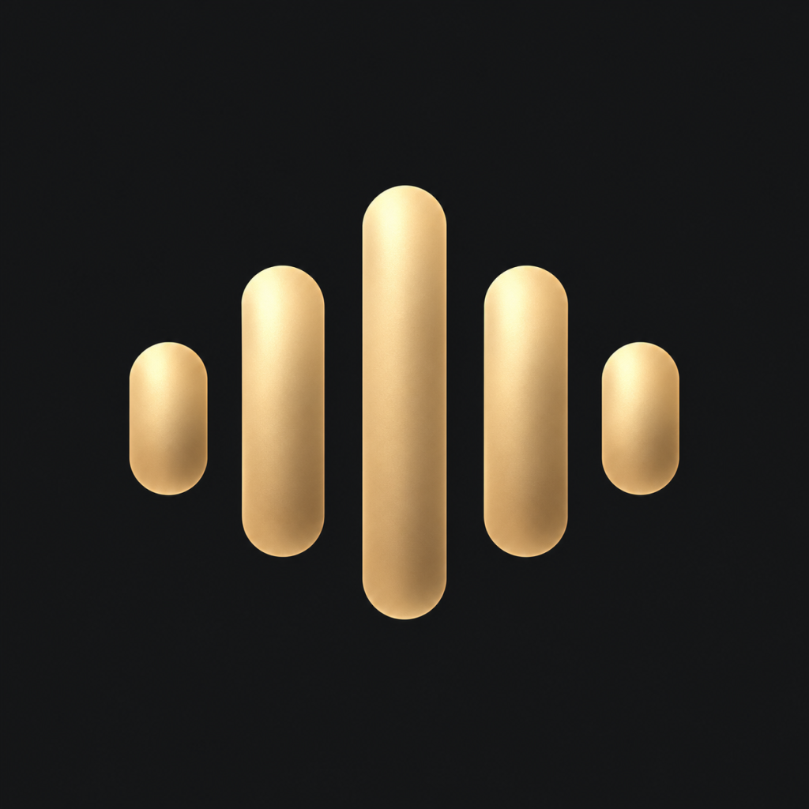
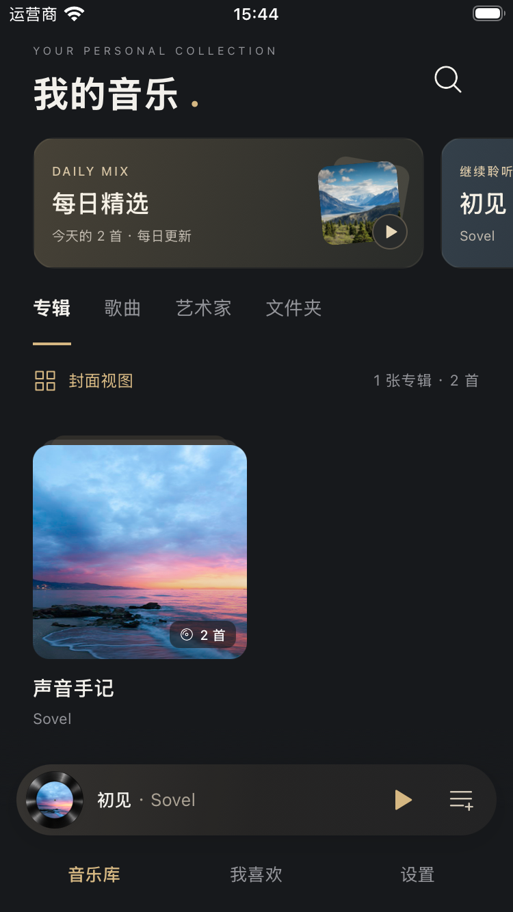
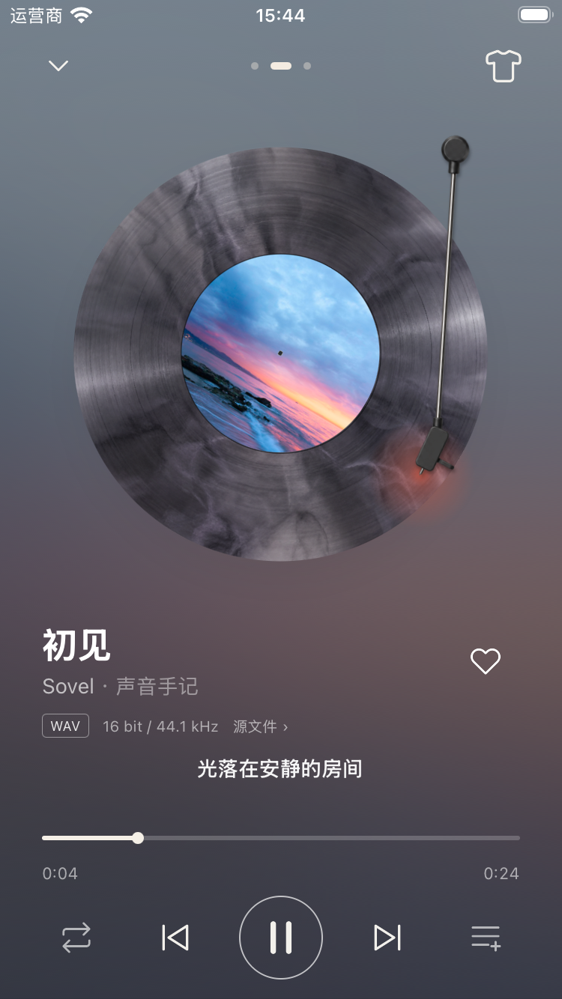
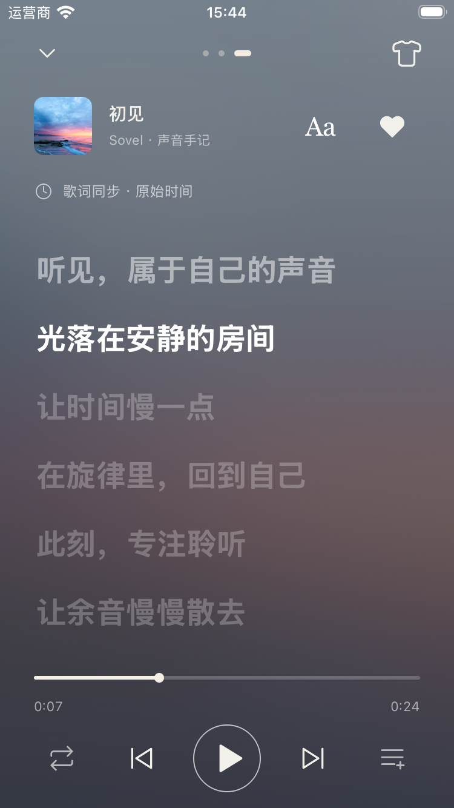

<p align="center"></p>
<h1 align="center">Sovel HiFi</h1>
<p align="center">Your music. Your library. Your listening space.</p>
<p align="center"><strong>English</strong> · <a href="README.zh-CN.md">简体中文</a></p>

Sovel HiFi is an open-source, cross-platform music player being built for local and remote libraries. It combines a charcoal-and-gold library, customizable vinyl visuals, and a dedicated lyrics view with a focus on the music you own.

**Development preview.** Local-library features are implemented, with playback and native EQ verified on the iOS simulator. Android code is included; Android builds and hardware behavior still need validation. Remote libraries and dedicated HiFi output are on the roadmap. The app UI currently uses Simplified Chinese; documentation is available in English and Chinese.

## A look inside

| Music library | Vinyl player | Synchronized lyrics |
| :---: | :---: | :---: |
|  |  |  |

Actual iOS simulator screenshots using the project's original listening samples. The browser demo is a separate design preview.

## What you can use today

- **Bring your own files.** Index authorized files and folders in place. Copying audio into the app is a separate, explicit action.
- **Scan without rebuilding your library.** Discover files first, then import against a fixed total. Incremental and full scans preserve favorites and preferences, with filters for size, hidden files, and subfolders.
- **Browse your collection.** Albums, songs, artists, folders, search, favorites, and independently remembered card/list views for albums and artists.
- **Make playback your own.** Cover, vinyl, and immersive views; nine record materials, two tonearms, cartridge colors, stylus lighting, and three rotation speeds.
- **Read and adjust lyrics.** Separate lyrics and song-information pages, timestamp highlighting, tap-to-seek, and per-song timing adjustments.
- **Pick up where you left off.** Restore the queue, order, track, and position after restart, initially paused. Background playback, lock-screen controls, and a native sleep timer are included.
- **Shape the sound.** Native ten-band EQ, six built-in presets, custom presets, preamp control, and automatic headroom. iOS processing is verified; Android integration awaits validation.
- **Keep preferences local.** SQLite stores the library and listening history. Export settings and EQ presets to JSON and restore after a preview. Local discovery uses library tags, favorites, and listening history.

## Capability status

| Area | Current status |
| --- | --- |
| Local files and folders | Implemented; iOS access-in-place and restart recovery verified |
| WAV / FLAC | Metadata and iOS playback verified with bundled samples |
| DSF | ID3 tags, artwork, and lyrics parsing verified; playback not enabled |
| Other audio formats | Platform- and codec-dependent; no blanket compatibility claim |
| Ten-band EQ | Native integration on both platforms; iOS processing and presets verified |
| Background playback / sleep timer | Native implementation; iOS simulator checks passed; real-device checks remain |
| SMB / WebDAV / DLNA / OpenSubsonic | Planned |
| PEQ / AutoEQ / ReplayGain | Planned |
| USB exclusive output / DoP / native DSD | Planned; requires Android and DAC validation |
| Bit-perfect / guaranteed gapless playback | Not verified or promised by the current build |

File bit depth and sample rate describe the source, not the DAC output. Metadata parsing, decoding, and output capabilities are tracked separately. See the [mobile development guide](mobile/README.md) for details.

## Build the native app

Use a Node.js version supported by [mobile/package.json](mobile/package.json), such as 22.13+ on the 22.x line, and npm. iOS requires macOS, Xcode, and CocoaPods. Android requires JDK 21, the Android SDK, and a device or emulator.

```sh
git clone https://github.com/quguai/sovel-player.git
cd sovel-player/mobile
npm ci
```

For iOS:

```sh
cd ios
pod install
cd ..
npm run ios
```

For Android:

```sh
npm run android
```

`npm start` runs Metro separately. Custom native modules require a native development build; **Expo Go is not sufficient**. Native projects are committed, so routine development does not require Prebuild. Installation and start scripts apply the maintained audio integrations automatically.

On an empty library, choose **先听两段原创试听曲** to import two original 24-second WAV/FLAC samples with artwork and timed lyrics. For your own music, open **设置 → 文件扫描** (Settings → File scanning) and select a source.

## Explore the browser demo

From the repository root:

```sh
npm run dev
```

Open [localhost:4786](http://localhost:4786). No dependency installation is needed for the preview. It listens on the local machine only; use `PORT=4787 npm run dev` to change the port.

The browser demo has its own state and does not share the native SQLite library. Demonstration tracks and quality labels are illustrative; native audio processing and hardware output are not represented by this preview.

## Development

| Component | Implementation |
| --- | --- |
| UI and application logic | React Native 0.88, React 19.3, TypeScript, Expo SDK 58 |
| Library and preferences | SQLite via `expo-sqlite` |
| Metadata | `music-metadata` with a random-access tokenizer |
| Playback | `expo-audio` 58.0.9, AVFoundation on iOS, Media3 on Android |
| Graphic EQ | Shared C++ DSP with platform-native integration |
| File access | Android SAF and an iOS security-scoped bookmark module |

```text
mobile/       React Native app, native projects, DSP, and tests
docs/         Implementation notes, reference reviews, and screenshots
design/       Icon and artwork explorations
previews/     Browser design-preview images
app.js        Browser interaction demo
styles.css    Browser demo styling
```

From `mobile/`:

```sh
npm run check    # TypeScript and core tests
npm run lint     # ESLint
```

Current verification: 47 core tests pass; TypeScript passes; ESLint reports no errors and eight existing warnings. iOS simulator checks cover import, playback, lyrics, scanning, restart recovery, EQ, and presets. Android hardware and USB DAC output have not been validated. Native test commands are in the [development guide](mobile/README.md).

Contributions are welcome. Include reproduction steps and device, OS, and audio-format details for playback issues. Native audio changes should include platform-specific validation. Reference checkouts belong in the ignored `repos/` directory and are not dependencies or submodules.

## Roadmap

- Connect remote libraries through SMB, WebDAV, DLNA/UPnP, and OpenSubsonic; evaluate additional server adapters separately.
- Validate Android playback, SAF/SD-card access, interruptions, and background behavior on real devices.
- Extend decoding and output for DSD and additional lossless formats, with explicit per-device capabilities.
- Develop and verify Android USB exclusive output and vendor-specific internal DAC paths.
- Add PEQ, AutoEQ import, ReplayGain, playback transitions, and additional app languages.

## Credits and license

Licensed under the [MIT License](LICENSE). Existing third-party notices, including the [Expo starter notice](mobile/LICENSE), are retained.

[NeriPlayer](https://github.com/cwuom/NeriPlayer), [MusicFree](https://github.com/maotoumao/MusicFree), and [Auxio](https://github.com/oxycblt/auxio) informed feature and behavior research; their GPL/AGPL implementation code was not copied into this project. [music-metadata](https://github.com/Borewit/music-metadata) is an actual dependency. See the [reference inventory](docs/upstream-references.md) and [feature review](docs/feature-adoption-review.md) (Chinese).

Generated icon, turntable, and placeholder assets include provenance records in [mobile/assets](mobile/assets). Listening samples are synthesized by this project. Browser concept photography comes from Unsplash: [ocean](https://images.unsplash.com/photo-1475924156734-496f6cac6ec1), [mountains](https://images.unsplash.com/photo-1464822759023-fed622ff2c3b), [forest](https://images.unsplash.com/photo-1441974231531-c6227db76b6e), and [desert](https://images.unsplash.com/photo-1509316785289-025f5b846b35).
